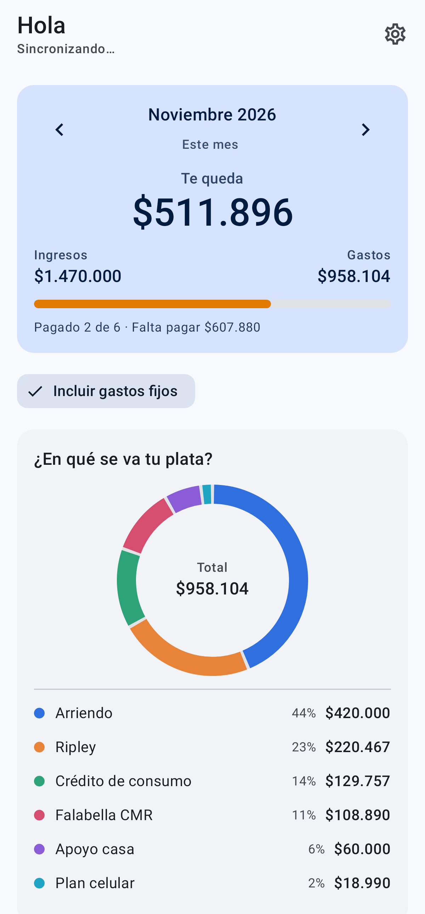
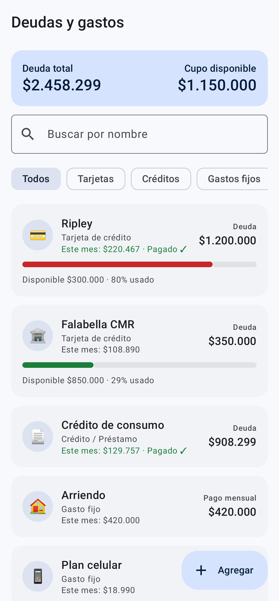
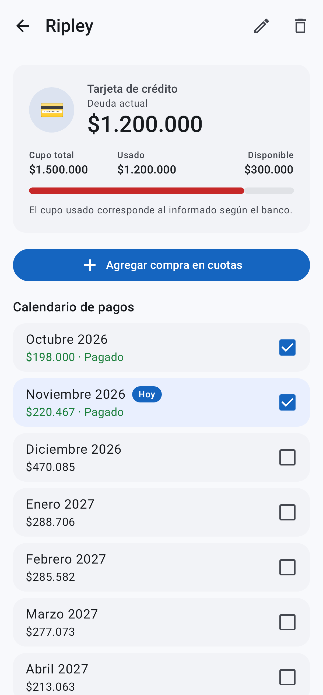
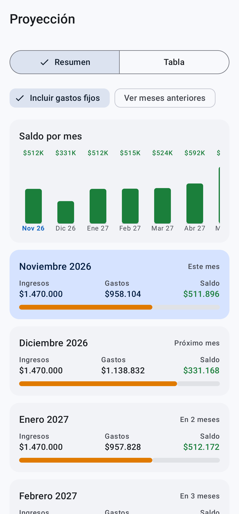
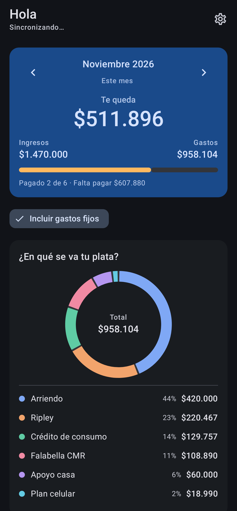
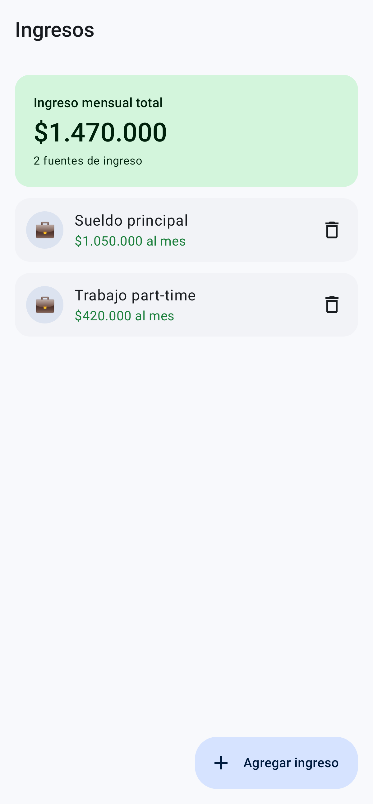
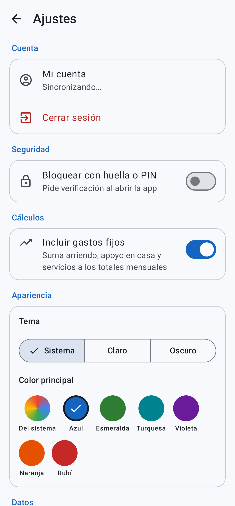
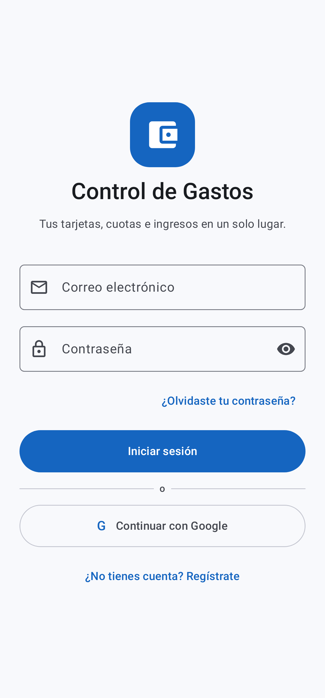

# Control de Gastos

App Android (Jetpack Compose + Material 3) para controlar tarjetas de crédito, cuotas, créditos,
gastos fijos e ingresos, y saber cuánto te queda cada mes. Los datos se guardan en el teléfono y se
sincronizan con tu cuenta en Firebase.

## Capturas

| Inicio | Deudas | Detalle | Proyección |
|---|---|---|---|
|  |  |  |  |

| Modo oscuro | Ingresos | Ajustes | Inicio de sesión |
|---|---|---|---|
|  |  |  |  |

## Funciones

- **Inicio**: saldo del mes (ingresos − gastos), pagado / pendiente, alerta de meses con déficit,
  gráfico de distribución y lista de pagos del mes para marcar como pagados.
- **Deudas**: tarjetas, créditos y gastos fijos con buscador y filtros. En cada una: cupo usado y
  disponible, calendario de pagos mes a mes y "Agregar compra en cuotas".
- **Ingresos**: tus sueldos u otras fuentes de ingreso mensual.
- **Proyección**: saldo de los próximos meses en gráfico y en tabla tipo Excel.
- **Ajustes**: tema claro / oscuro / sistema, color principal, bloqueo con huella o PIN, incluir o
  no gastos fijos, compartir un resumen, buscar actualizaciones y cerrar sesión.

## Estructura

```
app/src/main/java/com/example/controldegastos/
├── MainActivity.kt          # Tema, bloqueo biométrico
├── data/                    # Modelos, JSON, repositorio (local + Firestore), ajustes
├── domain/                  # FinanceCalculator: cálculos puros (con pruebas)
├── ui/
│   ├── AppRoot.kt           # Navegación, barra inferior, snackbar global
│   ├── FinanceViewModel.kt
│   ├── components/          # Campo de dinero, selector de mes, gráficos…
│   ├── screens/             # Una pantalla por archivo
│   └── theme/
└── util/                    # Formato CLP, meses, biometría
```

## Compilar

Requiere Android Studio (o JDK 21 + Android SDK).

```bash
./gradlew assembleDebug        # APK en app/build/outputs/apk/debug/
./gradlew testDebugUnitTest    # pruebas unitarias
```

## Firebase

- **Authentication**: habilitar *Correo/contraseña*. Para *Continuar con Google* hay que habilitar
  Google, registrar la huella SHA-1 de la app y volver a descargar `app/google-services.json`.
- **Firestore**: los datos de cada usuario están en `users/{uid}/data/financial_info`.
  Reglas recomendadas:

  ```
  match /users/{uid}/{document=**} {
    allow read, write: if request.auth != null && request.auth.uid == uid;
  }
  ```
- **Remote Config** (actualizaciones): `latestVersionCode`, `latestVersionName`, `apkUrl`, `updateNotes`.

Los datos de la versión 1 (montos por columna) se migran automáticamente al abrir la versión 2.
